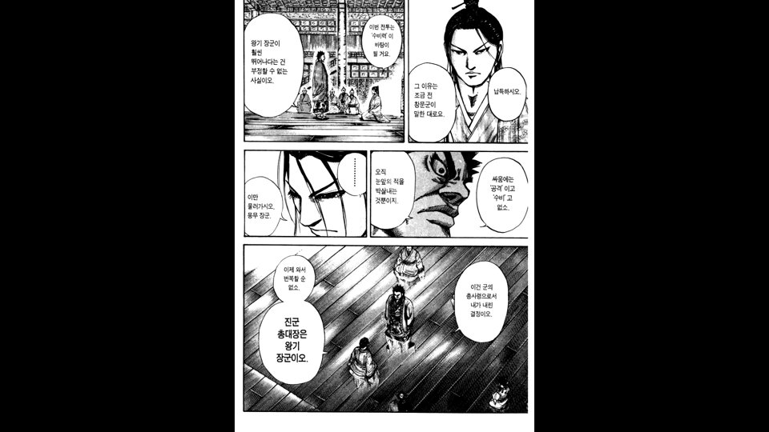
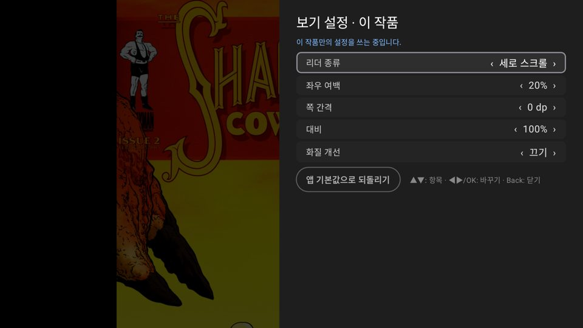

# 대비 · Lanczos

작업: Claude — 2026-11-01 (사용자: "작품별 설정에 콘트라스트 조절항목", "필터에 Lanczos 같은것도", "다른 버젼이 있으면 더 넣어줘 조금더 고성능")

- **대비**(작품별): 50~150%, 5%씩. 화면에 그릴 때 GPU 색 행렬로(가운데 회색 기준) — 페이지 넘김·세로 스크롤 모두, 부담 없음.
- **화질 개선에 Lanczos2(빠름) / Lanczos3 / Lanczos4(고품질)**: 쪽을 디코딩한 뒤 화면에 그릴 크기로 CPU 리샘플링(`Lanczos.kt`). 숫자는 창 크기 — 클수록 윤곽이 또렷하고 계산이 늘어난다. 가로·세로 두 단계, 줄마다 여러 코어로 나눠 한다. 미리 받는 쪽에서 미리 처리.
  - 페이지 넘김: Coil 변환(`LanczosTransformation`), 세로 스크롤: 타일 디코딩(`TileDecoder`).
- 확인: 단위 테스트 164개, lint 0. 에뮬레이터에서 킹덤 11권(68쪽, 넘기지 않음)에 대비 130% + Lanczos4 → 검정이 진해지고 선이 또렷. 확인 뒤 작품 설정 초기화.

## 세로 스크롤에도 대비 (1.0.2 / b17)
- 대비 항목을 페이지 넘김 전용 줄에서 빼서 두 모드 공통(작품별)으로. 에뮬레이터: 소림카우보이 2권 세로 스크롤에서 130% 적용 확인 후 원래 설정으로 되돌림.

