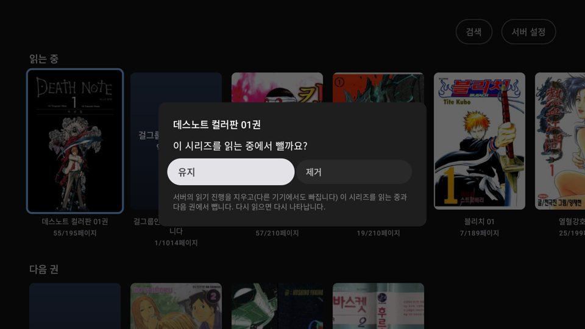

# EPUB 제목 · 표지 없는 책 · 읽는 중에서 빼기

작업: Claude — 2026-11-01 (사용자: "읽는중으로 추가된 epub파일 제목이 깨지는데", "읽는 중인 책을 길게 누르면 읽는중인 목록에서 삭제하는 기능, 다음권도 알려줄 필요 없고")

## EPUB 제목이 해시로 보이던 것
- 원인: 그 EPUB의 파일 이름이 해시(`a67879a1d4464860c3eedc980bd12118`)라 Komga 책 이름도 해시. 리더는 해시면 시리즈 제목을 쓰는데(`displayName`), 홈·검색 카드는 "글자가 있으면 이름 그대로" 규칙을 따로 써서 a~f 글자가 든 해시를 걸러내지 못했다.
- 고침: `Book.cardTitle()` 하나로 — 해시면 시리즈 제목, "01"처럼 번호뿐이면 "시리즈 01", 아니면 이름. 홈·검색이 같이 쓴다.

## 표지가 없는 책
- Komga가 표지 그림이 없는 책(이 EPUB 등)에 404를 준다. 회색 빈 칸 대신 제목을 적은 대체 표지(남색)를 보인다 (`PosterCard`).

## 읽는 중에서 빼기
- 홈의 "읽는 중"·"다음 권" 책을 OK 길게 → "이 시리즈를 읽는 중에서 뺄까요?" **[유지] [제거]** (유지에 먼저 포커스). [제거]를 눌러야 뺀다.
- 길게 누른 손을 뗄 때의 키가 메뉴 버튼을 눌러 버리던 문제(실기에서 길게 누르면 바로 지워짐)를 막았다 — 메뉴를 연 누름의 반복·손 떼기는 버린다(라이브러리 메뉴도 같이). 그 시리즈가 두 줄 모두에서 빠진다(다음 권도 안 보임).
- 읽던 책이면 **서버의 읽기 진행도 지운다**(사용자 요청 — 다른 기기에서도 빠진다). "다음 권"은 서버에 지울 진행이 없어 이 TV에만 숨김을 저장(`HomePreferences`, 시리즈 ID → 뺀 시각).
- 그 시리즈를 다시 읽으면(서버의 마지막 읽은 시각이 뺀 시각보다 뒤) 다시 나타나고 기록을 지운다. 다른 기기에서 읽어도 같다.
- TV 시계가 서버보다 늦어도 방금 뺀 책이 "다시 읽음"으로 보이지 않게, 뺀 시각은 그 책의 읽은 시각보다 뒤로 잡는다.

## 확인
- 단위 테스트 159개 통과, lint 경고 0. 새 테스트: 빼기·다시 읽으면 돌아오기(뷰모델), 줄 거르기 2개, 저장 코덱.
- 에뮬레이터: EPUB이 "걸그룹인데 악마와 계약했습니다" + 대체 표지, 길게 눌러 빼기 → 바로 빠지고 앱을 다시 켜도 유지.
- 시험으로 에뮬레이터에서 "그 남자! 그 여자!"를 뺐다(에뮬레이터에만 저장, 실제 TV와 서버는 그대로).

