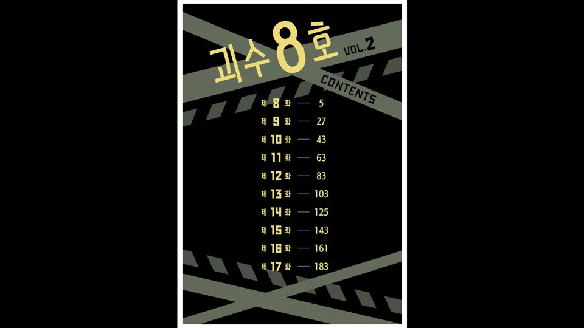
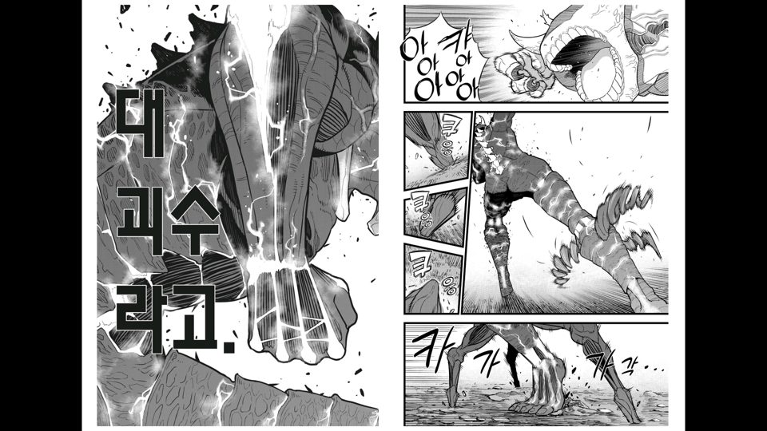
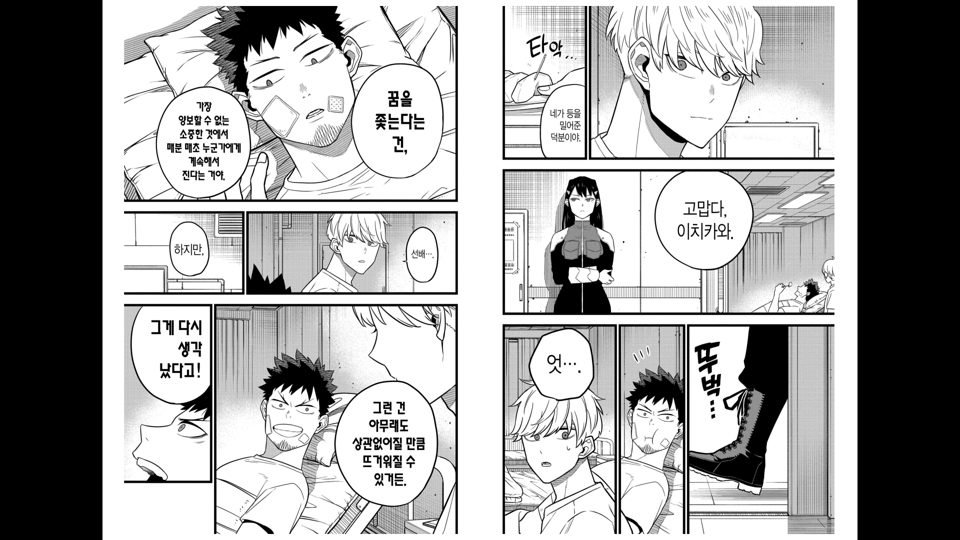

# PDF 보기 속도 개선

작업: Claude — 2026-11-01 (사용자: "PDF파일 볼때 조금 느린 느낌", "괴수8호로 테스트, 서버쪽은 설정 불가", "두쪽보기로 테스트")

## 측정 (고치기 전, 에뮬레이터 + 실제 서버, 괴수 8호 02)
- 쪽 하나 받기 **1.6~3.7초**, 0.25~3.3MB. Komga는 PDF 쪽을 요청마다 PDFBox로 그림을 그리고 이미지로 인코딩해서 보낸다(`PdfExtractor.getPageContentAsImage`).
- 같은 쪽을 두 번 받음: 미리 받기와 화면 요청이 동시에 같은 쪽을 부르고 Coil은 진행 중인 요청을 합치지 않는다.
- 미리 받기는 취소되지 않음: 빨리 넘기거나 10쪽씩 건너뛰면 받을 쪽이 수십 개 쌓여 1분 넘게 밀린다.
- 그 대기열을 API 호출과 같이 써서(한 OkHttpClient, 서버당 5개) 진행 저장·목록이 그 뒤에서 기다렸다 — 시험 중 진행 저장 실패, "로딩 중…"이 오래 감.

## 고친 것 (서버 설정은 그대로)
1. **PDF는 원래 쪽으로 받아 TV에서 그린다** — 페이지 넘김에서 `/pages/{n}/raw`(Komga가 그 쪽만 잘라 보낸 작은 PDF, 그리기·인코딩 없음)를 받아 안드로이드 PdfRenderer로 화면 크기에 맞춰 그린다(`PdfPageDecoder`, Coil 디코더). 세로 스크롤 PDF는 그대로(서버 그림).
2. **이미지 요청 대기열 분리** — 세션에 이미지 전용 클라이언트(연결·인증은 공유, 대기열만 따로, 서버당 4개). 진행 저장·목록은 이미지를 기다리지 않는다.
3. **같은 이미지를 동시에 부르면 한 번만** — `InFlightDedupInterceptor`. 앞 요청이 실패·취소되면 뒤 요청이 직접 받는다.
4. **멀어진 미리 받기는 취소** — 지금 쪽 기준 이웃이 아니게 된 미리 받기를 끊어 대기열이 쌓이지 않는다(지금 보이는 쪽은 끊지 않음).
5. 이미지 디스크 캐시 100MB → 512MB.

## 결과 (같은 책)
| | 고치기 전 | 고친 뒤 |
|---|---|---|
| 쪽 하나 받기 | 1.6~3.7초 | **0.17~0.26초** |
| 쪽 크기 | 0.25~3.3MB | 0.04~0.9MB |
| 같은 쪽 중복 | 있음 | 없음 |
| 두 쪽 보기, 10번(20쪽) 연속 넘김 | — | 1초 안에 마지막 펼침 표시, 지나간 쪽 요청은 바로 취소 |

화질: TV가 화면 크기로 직접 그려 글자가 또렷하다(스크린샷).

## 확인
- 단위 테스트 145개, 실패 0, lint 경고 0(core:ui 외부 라이브러리 경고만). 새 테스트: 중복 요청 합치기 4개, PDF 그릴 크기 3개, PDF 책 raw 주소 1개.
- 시험 뒤 되돌림: 괴수 8호 01 = 13/210쪽, 02 = 미독, 작품 보기 설정 초기화. (첫 측정 때 02 1쪽에서 왼쪽 키로 01 끝으로 넘어가 01 진행이 206쪽으로 바뀌었던 것도 13쪽으로 되돌림)

