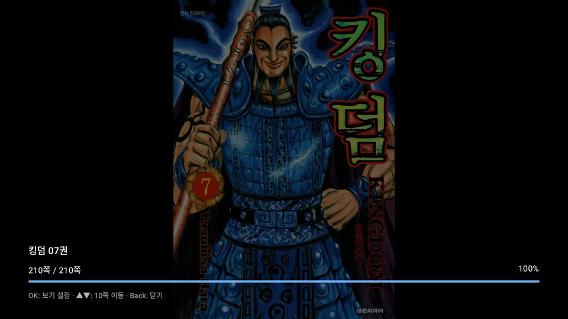
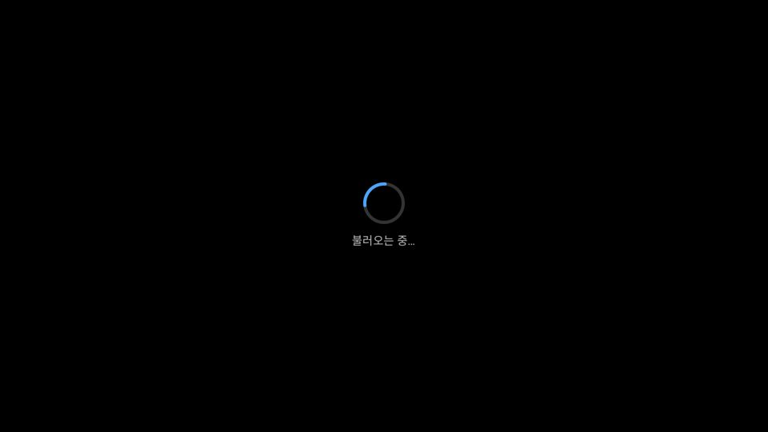
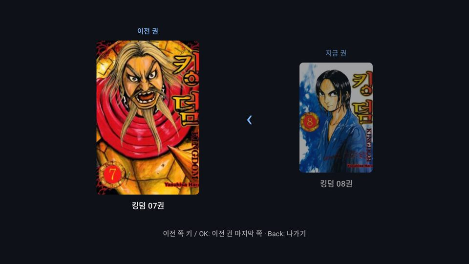
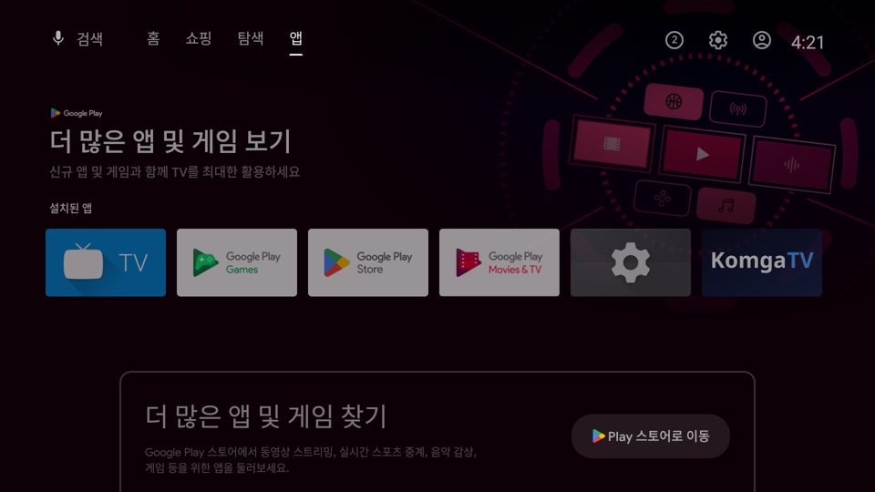
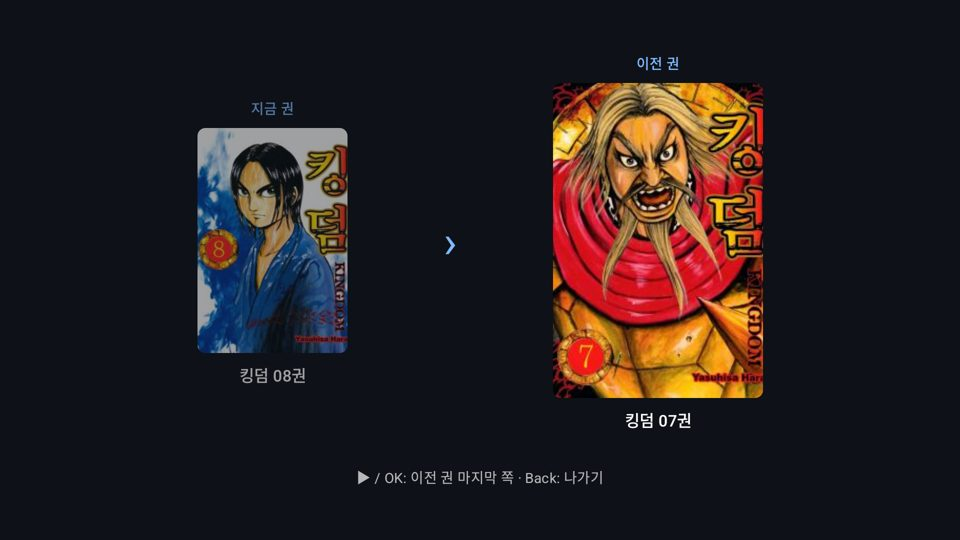
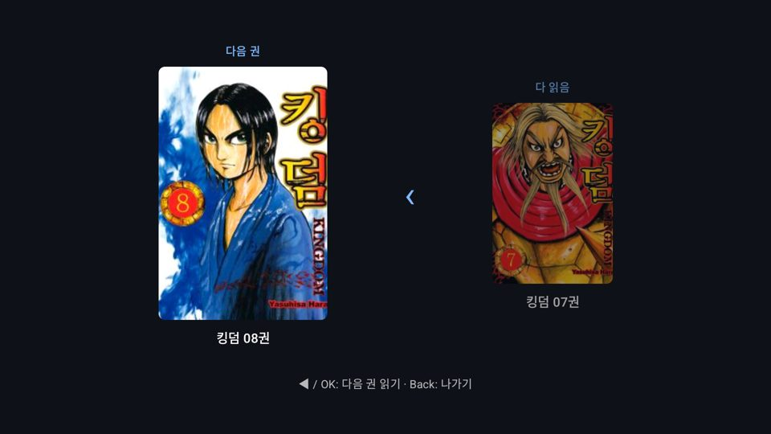
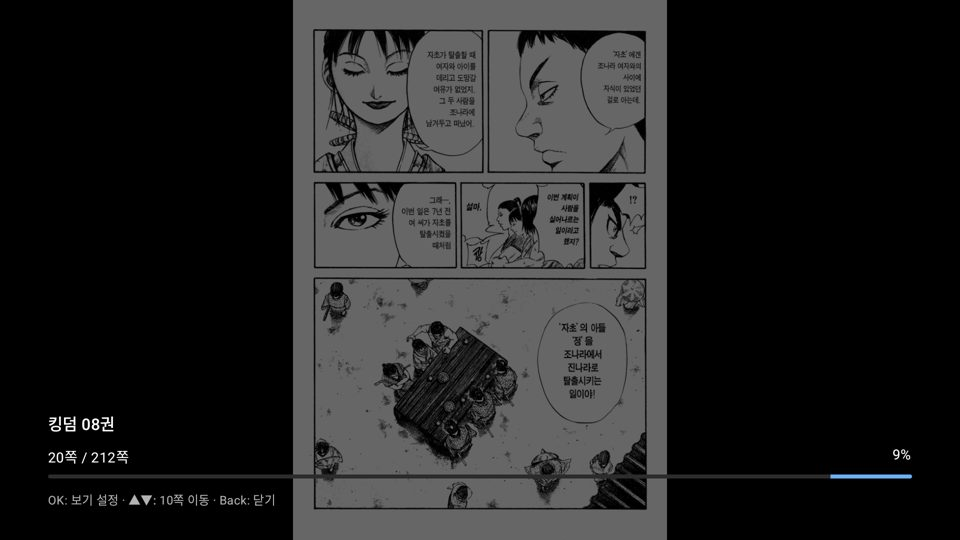

# 이전 권으로 가기 · 쪽 로딩 표시 · TV 배너 갱신

작업: Claude — 2026-11-01 (사용자: "빠르게 페이지를 넘기다 보면 … 블랙스크린이 나올때가 있는데 로딩중이었다면 표시해야지",
"8권을 열자마자 7권으로도 갈수 있게 해줘 (같은 작품에서)", "안드로이드TV 데쉬보드용 아이콘도 바꿔줘")

## 이전 권 (다음 권의 거울)
- `BookRepository.getPreviousBook` — Komga 이전 권(`/books/{id}/previous`), 첫 권이면 null.
- 페이지 넘김: 첫 펼침에서 뒤로 → **책 첫 화면**(지금 권과 이전 권 표지·제목, 책 끝 화면과 같은 모양 — 어느 쪽에 두는지는 읽기 방향을 따른다, 아래 "읽기 방향에 맞춘 배치" 표). 한 번 더(이전 쪽 키·OK) → 이전 권 **마지막 쪽**. 앞으로 → 1쪽. 첫 권이면 "이 시리즈의 첫 권입니다".
- 세로 스크롤: 1쪽 위에 같은 책 첫 카드. 맨 위에서 위·이전 → 이전 권 끝. 처음 열 때는 카드 아래 첫 타일에서 시작.
- 처음 근처(앞쪽 펼침 3개 이하)에서 열거나 오면 이전 권을 미리 찾고 마지막 두 쪽을 미리 받는다 — 8권을 열자마자 7권으로 바로 간다.
- 넘어가기 직전 지금 책 진행을 저장. 이전 권은 끝에서 열기만 하고 진행은 건드리지 않는다(쪽을 넘겨야 저장).

## 쪽 로딩 표시
- 쪽(타일)이 0.25초 안에 안 뜨면 돌아가는 표시 + "불러오는 중…". 그보다 빠르면 아무것도 안 보여 깜빡이지 않는다.
- 받지 못하면 "이 쪽을 불러오지 못했습니다. 다른 쪽으로 갔다 오면 다시 받습니다."
- 미리 받기를 앞쪽으로 늘림: 앞 4·뒤 2 펼침, 가까운 것부터(+1, +2, −1, +3, +4, −2).

## TV 배너 (대시보드)
- 배너·아이콘 그림은 이미 KomgaTV 워드마크. 런처가 같은 versionCode의 예전 배너를 기억할 수 있어 **versionCode 2 / 0.2.0**으로 올림.
- 활동(activity)에도 banner·icon, 앱에 roundIcon·logo 지정 — 활동 정보를 읽는 런처도 같은 그림을 쓰게.
- 실기 TV에서 예전 그림이 남아 있으면: 앱 삭제 후 새로 설치하거나 TV를 다시 켜면 런처 캐시가 새로 읽힌다.

## 확인
- 단위 테스트 137개, 실패 0, lint 경고 0. 새 테스트 4개: 첫 화면 → 이전 권 마지막 쪽(로딩 화면 없음, 이전 권 진행 그대로, 마지막 쪽 프리로드), 첫 권, 중간에서 열면 미리 찾지 않음, 세로 스크롤.
- 에뮬레이터(실제 서버, 킹덤 8권 3쪽): 뒤로 3번 → 첫 화면에 7권(바로 찾음) → 0.6초 안에 7권 210/210쪽. 빠르게 15쪽 넘김 → 스피너 → 2초 뒤 쪽 표시. 세로 스크롤도 위 → 첫 카드 → 7권 끝 → 아래 → 끝 카드 → 8권 1쪽.
- 시험 뒤 되돌림: 8권 3/212쪽, 7권 완독, 킹덤 작품 보기 설정 초기화.

## 읽기 방향에 맞춘 배치 (사용자 요청, 2026-11-01)
원칙: **갈 권은 그리로 가는 키가 있는 쪽에** (`BoundaryLayout`).

| | 책 끝 화면 (다음 권) | 책 첫 화면 (이전 권) |
|---|---|---|
| 왼쪽→오른쪽 | 다 읽음 › **다음 권**(오른쪽), ▶ | **이전 권**(왼쪽) ‹ 지금 권, ◀ |
| 오른쪽→왼쪽 (만화) | **다음 권**(왼쪽) ‹ 다 읽음, ◀ | 지금 권 › **이전 권**(오른쪽), ▶ |
| 세로 스크롤 | 왼쪽→오른쪽과 같은 배치, ▼ | 같은 배치, ▲ |

- 안내 문구도 실제 키(◀▶▲▼)로 표시.
- 오른쪽→왼쪽이면 정보 오버레이의 진행 막대가 오른쪽에서 왼쪽으로 찬다(Komga 웹 리더와 같음).
- 에뮬레이터: 킹덤을 잠시 오른쪽→왼쪽으로 바꿔 8권 1쪽에서 ▶ → 첫 화면(8권 › 7권), ▶ → 7권 끝, ◀ → 끝 화면(8권 ‹ 7권), ◀ → 8권. 확인 뒤 작품 설정 초기화, 8권 1/212·7권 완독 그대로.

