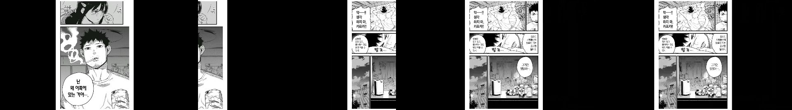
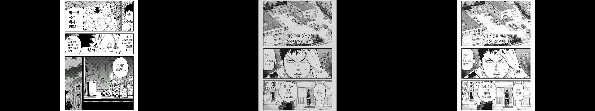
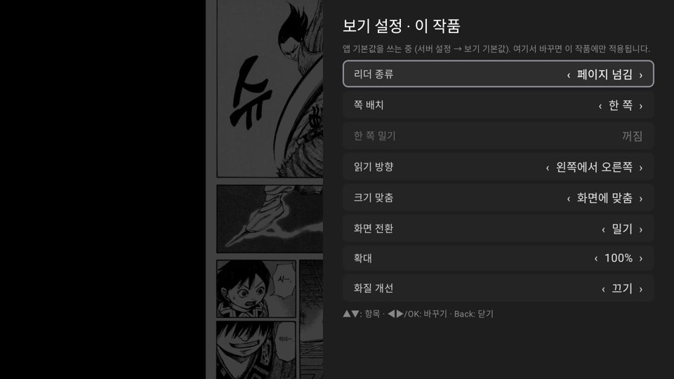

# 화면 전환 효과 · 작은 이미지 키우기 제거

작업: Claude — 2026-11-01 (사용자: "리소스를 가장 적게 쓰면서도 볼만한 화면 전환 효과", "넣어주세요",
"작은 이미지 키우기 옵션은 빼줘, 의미가 없어 기본이 키우기 여야함")

## 화면 전환 (페이지 넘김)
- 보기 설정에 **화면 전환: 끄기 / 밀기 / 페이드**, 기본 밀기(0.18초). 페이드는 0.15초.
- 이미 그린 화면을 옮기거나 겹치기만 한다(GPU) — 다시 그리거나 다시 받지 않는다.
- 밀기 방향은 읽기 방향을 따른다(오른쪽→왼쪽이면 다음 펼침이 왼쪽에서 들어온다).
- 효과 없이 바로 바꾸는 때: 0.3초 안에 연달아 넘길 때, 10쪽 점프, 책을 바꿀 때, 쪽 배치 등 설정을 바꿀 때, 다음 쪽이 아직 메모리에 없을 때(불러오는 중 표시).
- `AnimatedContent`의 transitionSpec은 한 전환에도 여러 번 불려 — 펼침이 바뀔 때 한 번만 정한다(`TransitionDecision`). 처음엔 두 번째 호출이 "연타"로 보고 효과를 꺼 버렸다(녹화로 확인 후 고침).

## 작은 이미지 키우기 제거
- 설정 항목을 없애고 늘 화면(쪽 너비)에 맞춰 키운다. 예전에 저장된 `stretchToFit` 값은 무시된다.
- 리더 패널이 한 줄 줄어 키 안내까지 한 화면에 들어간다.

## 확인
- 단위 테스트 155개 통과, lint 경고 0.
- 에뮬레이터 화면 녹화(screenrecord)로 밀기 11프레임, 페이드 8프레임 전환 확인.
- 시험 뒤 괴수 8호 01 = 17쪽으로 저장(앱 로그), 작품 설정 초기화.

