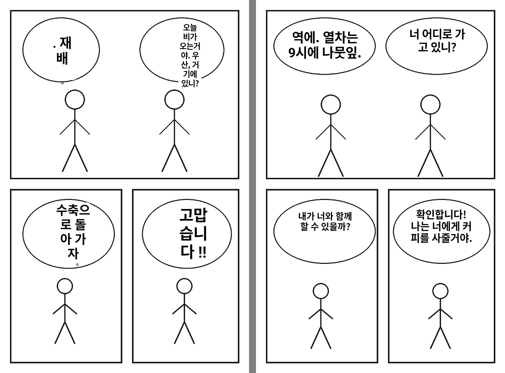
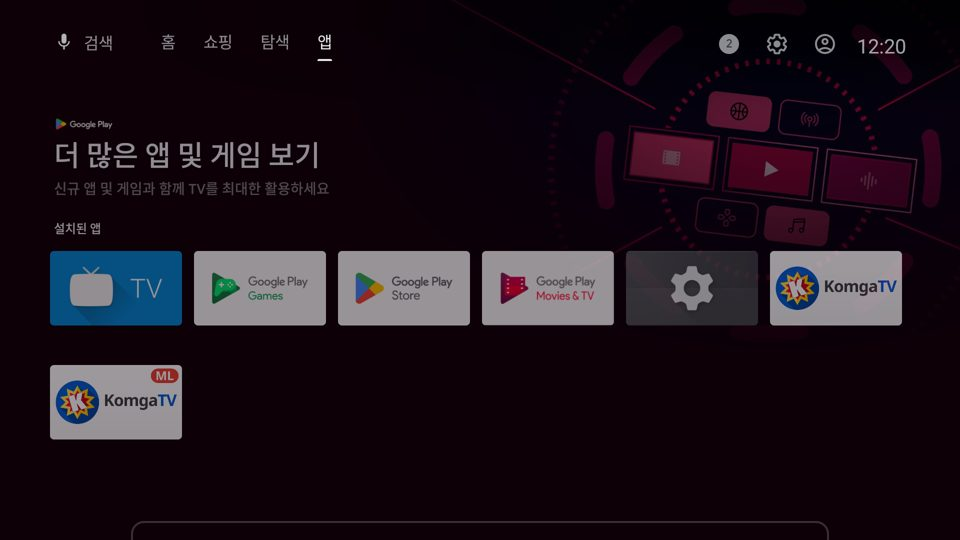

# 만화 번역 시험 (translate 브랜치)

작업: Claude — 2026-11-01 (사용자: "작품별 옵션에 만화책 텍스트 번역, 번역 후 원래 자리를 마스킹하고 번역 텍스트로 대체", 엔진은 TV 안에서 ML Kit, 일본어·영어 → 한국어)

## 구조
- 작품별 보기 설정 "번역: 끄기 / 일본어→한국어 / 영어→한국어" (페이지 넘김).
- 쪽을 디코딩한 뒤 Coil 변환(`TranslateTransformation`)에서: 글자 인식 → 덩어리 합치기 → 번역 → 원래 글자를 바탕색으로 가리고 번역문을 칸에 맞춰 쓴다. 이웃 쪽 미리 받기도 같은 요청이라 미리 번역된다.
- 글자 인식은 화면용 그림이 아니라 받아 둔 원본(이미지 디스크 캐시)을 높이 약 2200px로 다시 디코딩해 읽는다 — 1080으로 줄인 그림은 일본어 세로쓰기를 크게 틀린다(실험 결과).
- 세로 말풍선은 잘라 키워 한 번 더 읽고 일본어다운 쪽을 고른다. 세로쓰기의 "|"는 一/ー로 바로잡는다.
- 이미 한국어·숫자뿐·고른 언어가 아닌 글은 건너뛴다. 가리는 칸은 바탕색인 곳까지만 넓혀 말풍선 테두리는 남긴다.
- 결과는 쪽마다 저장(`cacheDir/translations`), 한 번에 한 쪽씩 처리.
- main 앱과 따로 설치: `com.komgatv.app.translate`, 이름 "KomgaTV 번역".

## 시험 (직접 그린 시험용 쪽, `docs/translate/make_test_pages.py`, 기기 테스트 `MangaTranslatorDeviceTest`)
| 원문 | 인식 | 번역 |
|---|---|---|
| 今日は雨だね。傘、ある？ | 맞음 | 오늘 비가 오는거야. 우산, 거기에 있니? |
| ないよ。忘れちゃった。 | 忘→培, 작은 ゃっ→やつ | . 재배 |
| じゃあ、一緒に帰ろう。 | じ→し, 緒→縮 | 수축으로 돌아 가자 |
| ありがとう！助かるよ。 | 助→勘 | 고맙습니다 !! |
| (영어 4개) | 모두 맞음 | 뜻은 통함, 직역 ("leaves"→나뭇잎, "Sure!"→확인합니다!) |

- 속도(에뮬레이터): 일본어 쪽 1.7초, 영어 쪽 0.7초. 실제 서버 책(후르츠 바스켓 표지, 영어)도 동작 확인.
- 한계: ML Kit 일본어 인식이 비슷한 한자를 한 글자씩 틀리고, ML Kit 번역은 직역이라 한 글자 오류가 엉뚱한 번역이 된다. APK 155MB(엔진이 CPU 종류별 4벌).

## 따로 설치 구별
- 번역 시험판 배너 오른쪽 위에 빨간 **ML**(머신러닝) 표시 — `make_banner.py ... ML`로 만든다 (main 배너에는 없음).

