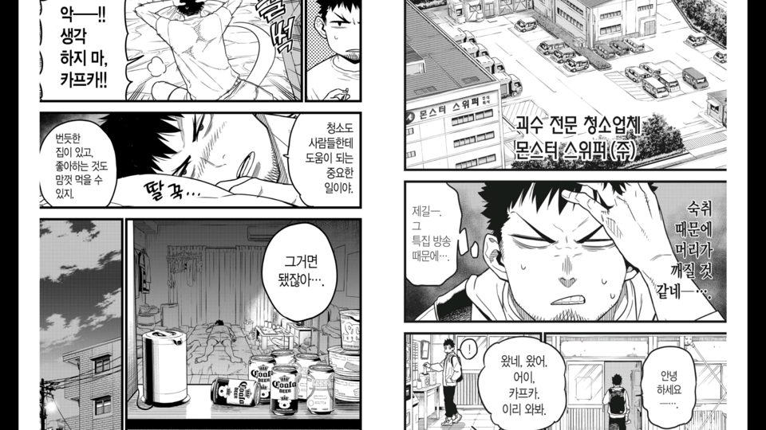
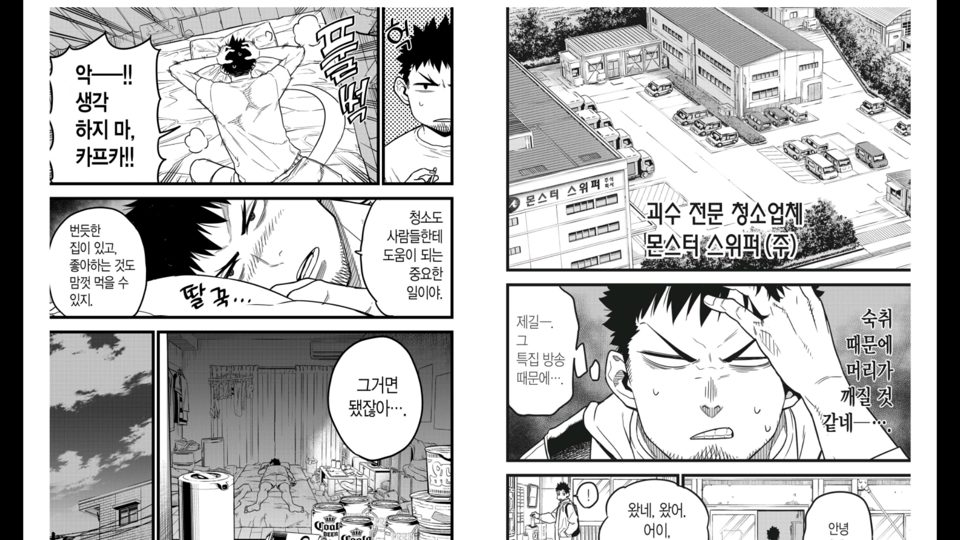
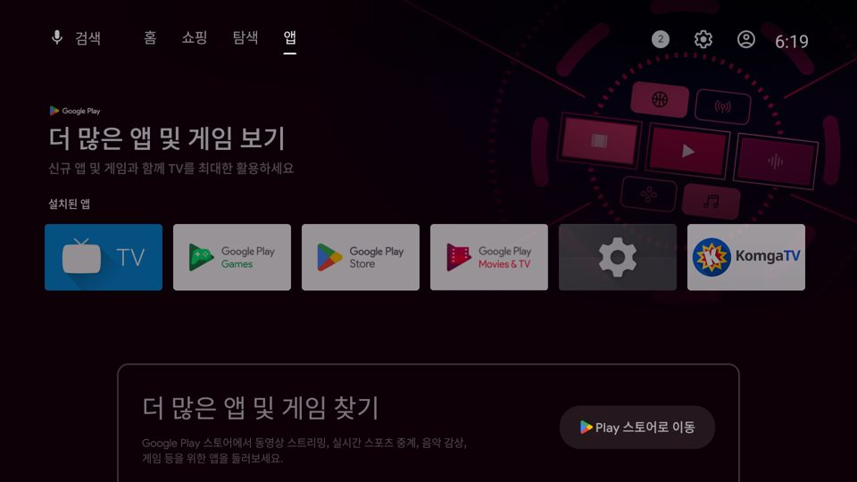

# 작품별 확대(줌인) · Google Play 스타일 배너

작업: Claude — 2026-11-01 (사용자: "작품별 설정에 확대가능을 넣어줘, 1퍼센트 단위로", "페이지 맞춤후의 결과에 대한 확대(줌인)",
"두페이지 보기에서도 문제 없어야함", "데쉬보드 아이콘에 콤가 로고가 안보이던데", "구글 플레이 스타일")

## 확대
- 리더 보기 설정(작품별)에 **확대** 줄 — 크기 맞춤으로 맞춘 결과를 100~300%, ◀▶ 1%씩(길게 누르면 계속). 서버 설정의 앱 기본값에는 없다.
- 두 쪽 보기: 펼침째(두 쪽 함께, 가운데 접히는 곳 기준) 확대 — 두 쪽이 벌어지지 않는다.
- 화면 맞춤·높이 맞춤: 화면 밖으로 넘치는 위아래는 ▲▼로 본다(반 칸씩, 쪽이 바뀌면 가운데로).
- 너비 맞춤·원본(스크롤): 위쪽 기준으로 키우고 키운 높이만큼 스크롤된다. 좌우 넘침은 잘린다.
- 작품 설정에만 저장(`zoomPercent`), "앱 기본값으로 되돌리기"면 100%.

## 배너·아이콘 (Google Play 스타일)
- 배너: 흰 바탕(아래로 아주 옅은 회색), 왼쪽 Komga 로고, 오른쪽 'Komga'(회색) + 'TV'(Komga 파랑) — 글자는 원래 비율, 자간은 조금 좁게(처음엔 세로로 늘렸다가 사용자 의견으로 되돌림).
- 앱 아이콘: 흰 바탕 가운데 Komga 로고, 테마 아이콘은 별과 K 실루엣. `docs/branding/make_banner.py`로 모든 밀도 생성.
- TV 런처는 배너를 기억한다 — 새 APK 설치 후 TV를 다시 켜야(재부팅) 새 그림이 보인다. 에뮬레이터는 런처를 다시 시작해 확인.

## 확인
- 단위 테스트 152개 통과, lint 경고 0. 새 테스트: 확대 1% 단위·100~300 제한·작품 저장, 저장된 확대로 열기·되돌리기, 코덱.
- 에뮬레이터: 두 쪽 보기 125% 확대 + ▲ 위쪽 보기. 시험 뒤 괴수 8호 01 = 17/210쪽, 작품 설정 초기화.

